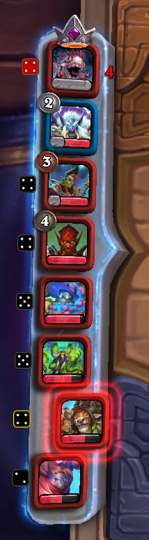
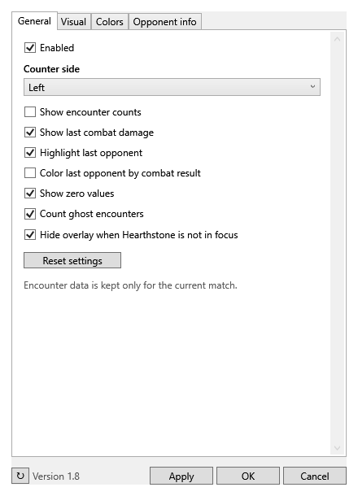
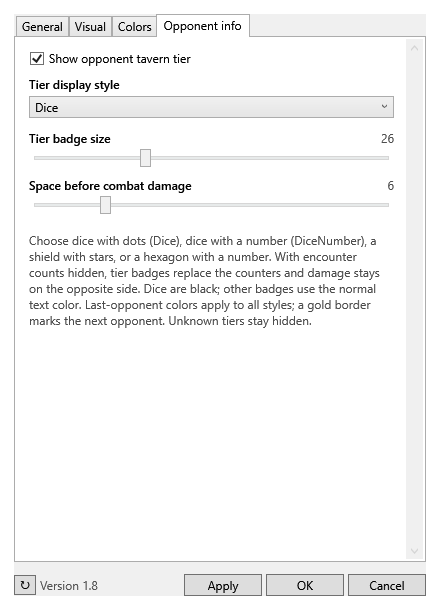

# Opponent Memory

Opponent Memory is a plugin for [Hearthstone Deck Tracker](https://github.com/HearthSim/Hearthstone-Deck-Tracker) that shows opponent tavern tiers, highlights your most recent opponent, and tracks completed encounters in Solo Battlegrounds.

See tavern tiers at a glance, quickly find your previous opponent when checking their last known warband, and optionally use encounter counts to help estimate who you might face next.

For the Windows version of HDT. Solo Battlegrounds only.

## Screenshots

### In game

### General settings

### Opponent info settings

## Features

* Shows opponent tavern tiers beside leaderboard portraits
* Offers four tier styles: dice with dots, dice with numbers, shields with stars, and hexagons with numbers
* Highlights the opponent from your most recently completed combat
* Marks the next opponent with a gold badge border when their tier badge is visible
* Shows damage dealt or taken in your latest combat against the most recent opponent, when known
* Optionally colors the previous opponent by combat result using custom win, loss, and draw colors
* Optionally shows how many completed combats you have played against each opponent
* Supports left/right placement, positioning, scale, fonts, text styles, colors, and opacity
* Can hide the overlay when Hearthstone is not in focus
* Includes a manual update checker
* Works locally without telemetry, analytics, or gameplay data uploads

## How it works

### Tavern tiers

By default, black dice with white dots show opponent tavern tiers on the left of the portraits. Seven dots represent tier 7. You can choose a number instead of dots, a shield with stars, or a hexagon with a number.

Tiers refresh as HDT receives new values, including during shopping. Unknown values stay hidden. The plugin does not predict upgrades or reveal changes before HDT receives them.

### Previous and next opponents

The most recent opponent uses the selected last-opponent color. Enable **Color last opponent by combat result** to use your win, loss, and draw colors instead. A gold badge border marks the next opponent. If the same player is both your previous and next opponent, the badge keeps the previous-opponent fill and the gold border.

Normal dice are black. Shields and hexagons use the normal text color. The color and next-opponent border apply to all four styles.

### Last combat damage

Damage appears only beside the opponent from your most recently completed combat. Its color follows the selected win, loss, and draw colors. A confirmed draw shows `0`; an unknown damage value stays hidden.

### Encounter counts and placement

Encounter counts are hidden by default. With tier badges enabled, hiding counts places the badges where the counters would be and leaves damage on the opposite side.

When counts are enabled, tier badges appear on the opposite side of the portraits, with damage farther out on that side. If no tier badge is available and counts are hidden, a colored dot can still mark the previous opponent.

Counts increase only after a combat is completed, at most once per round. Completed ghost encounters count by default; this can be disabled in settings.

Opponent Memory tracks opponents by temporary in-game Player IDs rather than names. Match data stays in memory and is cleared when the match ends, a new match starts, or the plugin is unloaded. Only plugin settings are saved.

## Configuration

Open `Options -> Tracker -> Plugins -> Opponent Memory -> Settings`.

* **General:** encounter counts, last combat damage, highlighting, placement side, ghost encounters, and hiding the overlay when Hearthstone is not in focus
* **Visual:** positioning, per-row alignment, scale, font, text style, and opacity
* **Colors:** normal text, last-opponent, combat-result, and background colors
* **Opponent info:** tavern tier visibility, badge style, size, and spacing before damage

The default layout uses dice on the left, hidden encounter counts, and last combat damage on the right. Existing settings are preserved when upgrading; use **Reset settings**, then **Apply**, to use the new defaults.

Use the `↻` button beside the installed version to check for updates. Checks run only when pressed and do not download or install files automatically.

## Limitations

* Battlegrounds Duos is not supported. The overlay stays hidden and encounter tracking stops outside Solo Battlegrounds.
* Tavern tiers and combat results depend on the information available to HDT. Missing data is not presented as a confirmed value.

## Installation

Download the ZIP from the [latest release](https://github.com/numbereleven-a/HDT-OpponentMemory/releases/latest).

### Drag and drop

1. Open `Options -> Tracker -> Plugins`.
2. Drag the downloaded ZIP into the plugins window.
3. Restart HDT and enable **Opponent Memory**.

### Manual install

1. Extract `OpponentMemory.dll` from the ZIP into `%appdata%\HearthstoneDeckTracker\Plugins`.
2. Restart HDT.
3. Enable **Opponent Memory** in `Options -> Tracker -> Plugins`.

If the plugin does not appear, right-click `OpponentMemory.dll`, open **Properties**, and select **Unblock** if available.

## Download

## License

[MIT](LICENSE)
